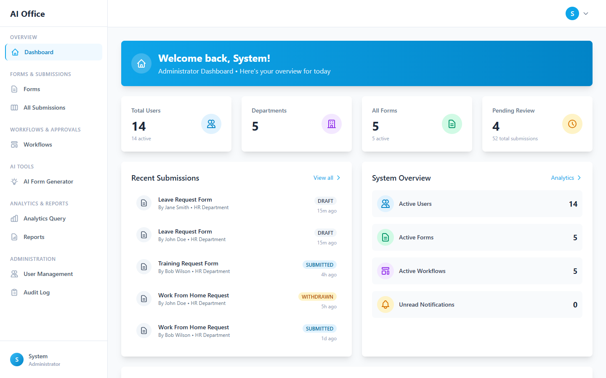
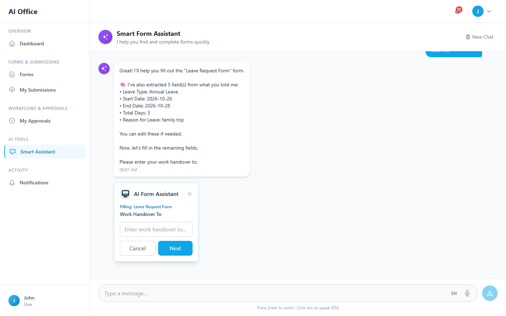
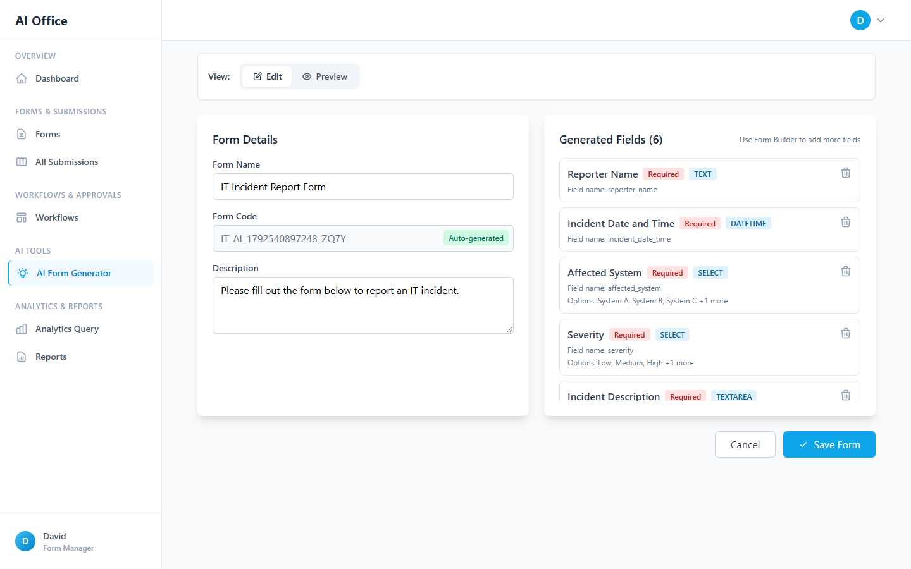
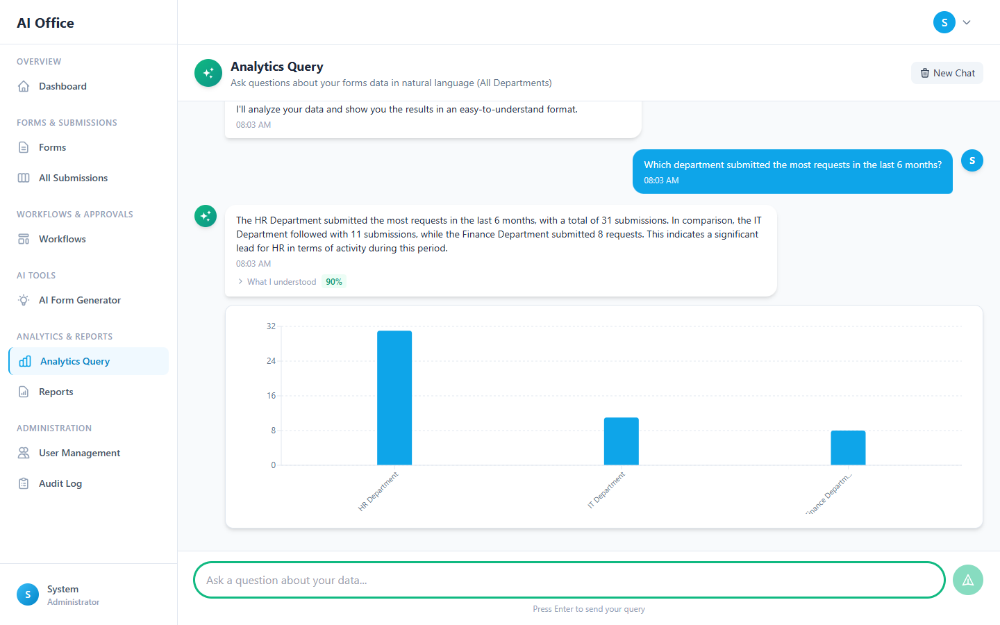
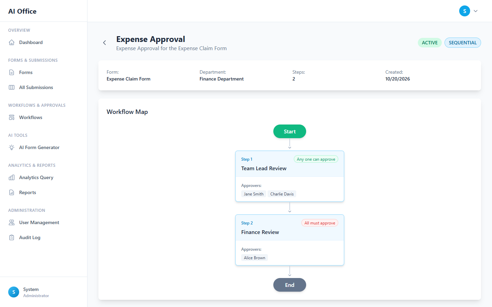
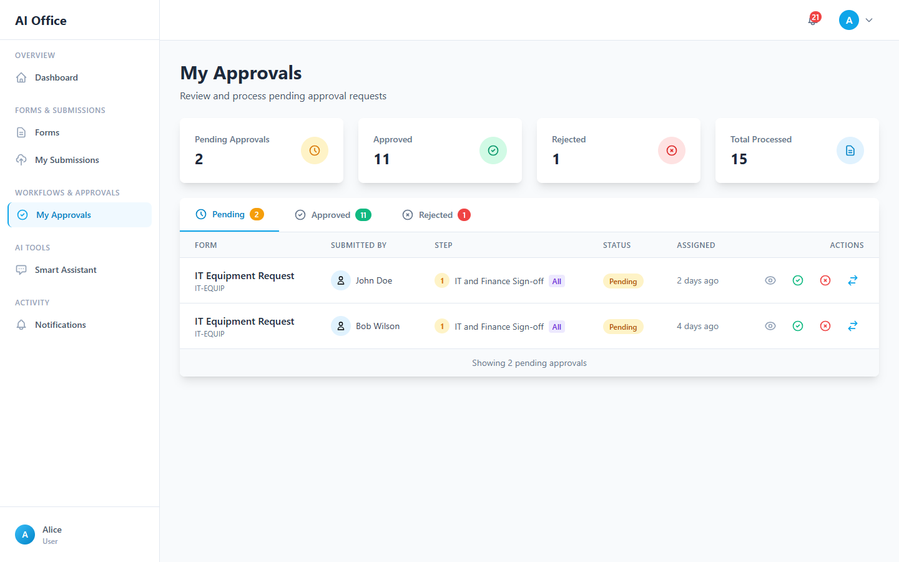
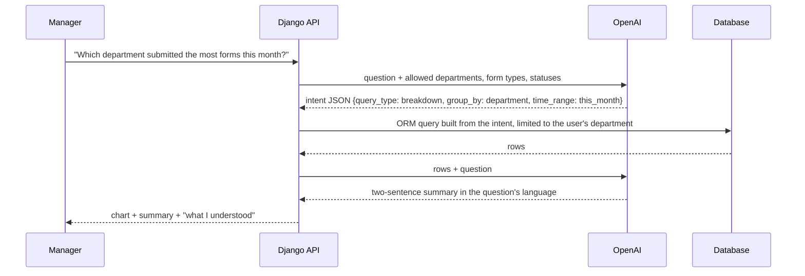
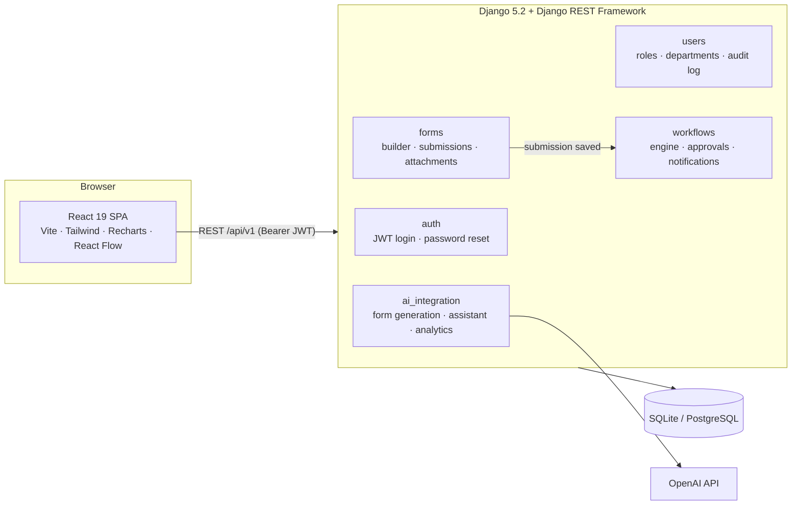

# AI Office Assistant

[](https://github.com/TCF1209/ai-form-assistant/actions/workflows/ci.yml)


An internal form and approval platform for companies. AI builds a form from one sentence,
fills a form from a conversation, and answers questions about the data in plain English
(or Chinese, or Malay). Behind it is a workflow engine that routes every request through
sequential or parallel approvals with ALL / MAJORITY / ANY voting.

Built as my Final Year Project (Computer Science, Artificial Intelligence).



## What it does

- **AI form generation**: a Form Manager describes the form ("an expense claim with receipt
  upload and amount limits"); GPT returns a typed schema that is validated, mapped onto the
  form builder's field types and opened for review before saving.
- **Smart Assistant**: an employee writes "I need 3 days off next week for a family event".
  The assistant picks the right form, pre-fills what it understood plus the employee's
  profile, asks only for what is missing, and submits.
- **Analytics in plain language**: "How many leave requests were rejected last month?"
  returns a number, chart or table with a short written summary, and follow-up questions
  keep their context.
- **Approval workflows**: managers design sequential or parallel workflows, choosing per
  step whether all, a majority or any one of its approvers must agree. Approvers approve,
  reject or delegate in *My Approvals*, and the submitter is notified of the outcome.

| Smart Assistant | AI form generator |
|---|---|
|  |  |
| **Analytics query** | **Workflow map** |
|  |  |
| **My Approvals** | |
|  | |

Also: drag-and-drop form builder with 35 templates, file attachments, drafts and withdrawals,
Excel/PDF reports, in-app notifications, user and department management, and an audit log.

## Engineering highlights

### The language model never touches the database
Analytics questions go through three steps:



The model only classifies the question into a small, validated intent; the backend builds
the query. That rules out prompt-injected SQL, keeps Form Managers inside their own
department (the scope is applied to the queryset, not asked of the model), and makes the
numbers reproducible. The interpretation is shown to the user so a misunderstanding is
visible.

### A workflow engine with explicit guarantees
[`workflows/engine.py`](backend/workflows/engine.py) turns a submission into approval tasks:

- **Types**: sequential, conditional (a step runs only when rules such as `amount > 1000`
  match the submission), and parallel with a percentage threshold.
- **Voting per step**: ALL, MAJORITY (a tie rejects) or ANY.
- **Nobody approves their own request**: the submitter is removed from the approvers; if no
  one is left, the task goes to an administrator and the request is flagged.
- **Decided means decided**: once a step has an outcome, its other open tasks are closed,
  so a late vote cannot re-run the step or flip a rejected request. Each decision locks the
  workflow instance row, so two approvers clicking at once are processed one after the other.
- **History is kept**: editing a workflow updates its steps in place instead of recreating
  them, so earlier requests keep their approval trail.

These rules are covered by 33 engine and API tests.

### Access control enforced on the server
Three roles: **Employee**, **Form Manager** (scoped to one department) and **Admin**.
Department scoping lives in each viewset's queryset, so another department's records are a
404, not a hidden button. Request status can only change through the workflow engine or the
dedicated approve/reject/withdraw endpoints; approval tasks and workflow instances are
read-only over the API. Authentication uses rotating JWT refresh tokens, and password resets
use single-use tokens that also sign the account out elsewhere.

### AI that fails safely
User input is checked (length, gibberish, profanity) before any model call, replies are
requested in JSON mode and parsed defensively, AI endpoints are rate-limited, and every AI
feature falls back to a usable message when the model is unavailable. In tests the OpenAI
client is mocked, so the suite needs no API key.

## Architecture



| Path | What lives there |
|---|---|
| `backend/workflows/engine.py` | Approval state machine |
| `backend/ai_integration/` | Prompts, OpenAI client, NL analytics query builder, chat history |
| `backend/forms/` | Forms, fields, 35 templates, submissions, attachment validation |
| `backend/users/` | Custom user model, departments, permissions, audit log, `seed_demo` command |
| `frontend/src/pages/` | One folder per screen (assistant, analytics, approvals, workflows, ...) |
| `frontend/src/services/api.js` | Axios client with single-flight token refresh |

## Running it locally

Requirements: Python 3.10+ and Node.js 20+.

**Backend** (http://localhost:8000)

```bash
cd backend
python -m venv .venv
source .venv/bin/activate        # Windows: .venv\Scripts\activate
pip install -r requirements.txt
python manage.py migrate
python manage.py seed_demo       # demo departments, users, workflows and ~50 requests
python manage.py runserver
```

The AI features need an OpenAI key. Copy `backend/.env.example` to `backend/.env` and set
`OPENAI_API_KEY` (the model defaults to `gpt-4o-mini`). Everything else works without it.
SQLite is used unless `DB_ENGINE` is set to PostgreSQL.

**Frontend** (http://localhost:3000)

```bash
cd frontend
npm ci
npm run dev
```

To host it, see [docs/deployment.md](docs/deployment.md): the API runs on Render's free plan
(`render.yaml`) and the React app on Vercel.

### Demo accounts

| Role | Username | Password | Try |
|---|---|---|---|
| Admin | `admin` | `Admin123!` | Dashboard, users, audit log, reports |
| Form Manager (IT) | `it_manager` | `Manager123!` | AI form generator, workflows, analytics |
| Employee | `john_doe` | `User123!` | Smart Assistant, submitting and withdrawing requests |
| Approver | `alice_brown` | `User123!` | My Approvals (has pending requests) |

Other managers: `hr_manager`, `fin_manager`, `mkt_manager`, `ops_manager`. Other employees:
`jane_smith`, `bob_wilson`, `charlie_davis`, `diana_miller`, `eric_taylor`, `fiona_clark`.

## Tests

```bash
cd backend
python manage.py test        # 113 tests
ruff check .

cd ../frontend
npm run lint
npm run build
```

GitHub Actions runs the same checks on every push.

## Limitations and next steps

- The workflow designer creates sequential and parallel workflows. Conditional routing works
  in the engine and API but has no designer screen yet.
- AI-generated forms can describe conditional fields ("show *Other reason* when *Other* is
  picked"); the form renderer does not apply those conditions yet.
- Notifications are in-app only; approval emails are not sent.
- The frontend has linting but no automated tests, and a few screens (Reports, Workflow
  Designer) are large single components that would be worth splitting.

## Project history

The version submitted for assessment in January 2026 is tagged
[`fyp-submission`](https://github.com/TCF1209/ai-form-assistant/tree/fyp-submission).
Afterwards I reviewed it end to end and fixed what I found: permission gaps that let an
employee approve their own request through the API, several workflow-engine edge cases,
file attachments that could not be saved, and token-refresh problems in the frontend. I also
added the test suite and CI, and moved to Django 5.2 LTS. The [commit history](https://github.com/TCF1209/ai-form-assistant/commits/main)
describes each change.

The original project proposal is in [docs/project-proposal.md](docs/project-proposal.md).
